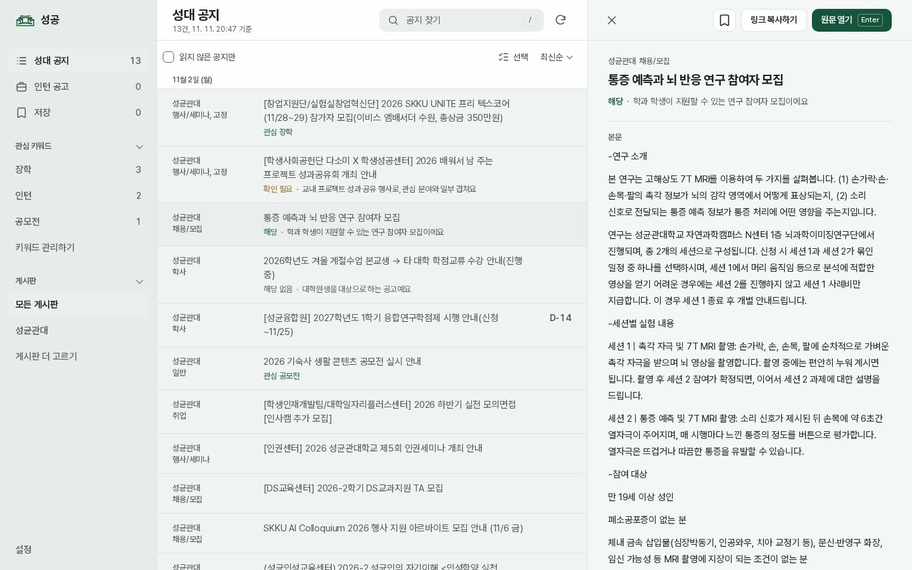
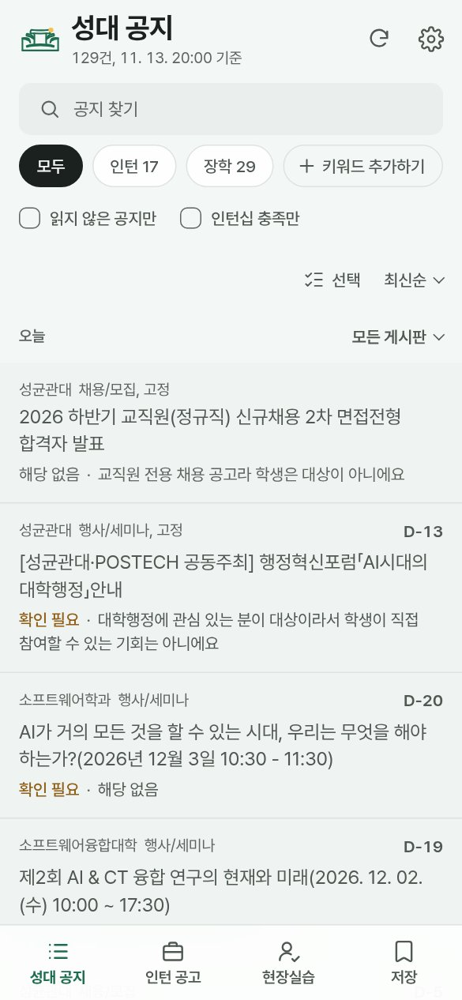
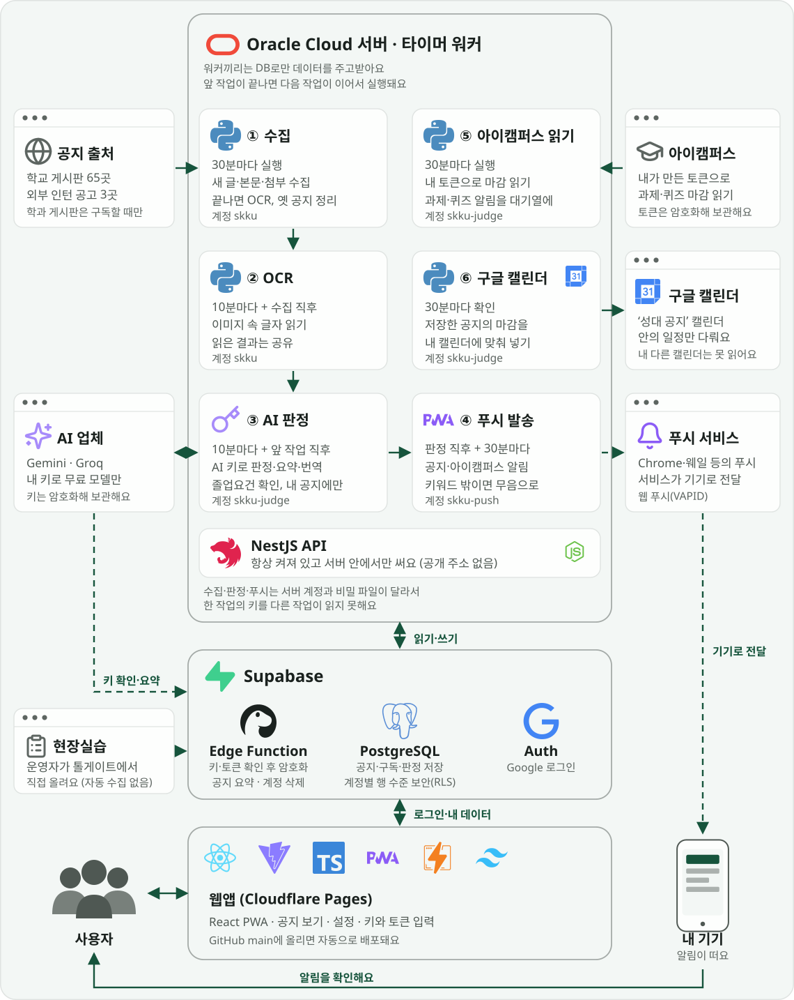

<div align="center">

<picture>
  <source media="(prefers-color-scheme: dark)" srcset="web/public/icon-192-dark.png">
  
</picture>

# 성공

성균관대 공지, 인턴 공고, 현장실습을 한곳에 모아 보고 나에게 맞는 소식만 알림으로 받는 웹 앱


[](https://skku-notice-platform.pages.dev/)

[](https://skku-notice-platform.pages.dev/)

[개인정보 처리방침](https://skku-notice-platform.pages.dev/privacy.html) · [문의하기](https://github.com/aniseongu/skku-notice-platform/issues)

</div>

Google 계정으로 로그인한 사람마다 구독한 게시판, 관심 키워드, 저장과 읽음 상태를 따로 가집니다. 공지를 가져오고 이미지 속 글자를 읽는 일은 Oracle Cloud 서버가 맡고, 웹은 Cloudflare Pages에서 서비스합니다. 혼자 쓰던 [개인용 성공](https://github.com/aniseongu/skku-notice-alert)을 여러 사람이 쓰도록 새로 만든 프로젝트입니다.

## 사용 화면

PC에서는 목록과 공지 상세를 함께 보고, 휴대폰에서는 아래 탭으로 성대 공지, 인턴 공고, 현장실습, 저장을 오갑니다.

<table>
<tr>
<th>PC</th>
<th>휴대폰</th>
</tr>
<tr>
<td>
<picture>
  <source media="(prefers-color-scheme: dark)" srcset="assets/readme/pc-list-dark.jpg">
  
</picture>
</td>
<td>
<picture>
  <source media="(prefers-color-scheme: dark)" srcset="assets/readme/mobile-list-dark.jpg">
  
</picture>
</td>
</tr>
</table>

화면은 GitHub의 라이트·다크 테마에 맞춰 바뀌며, 2026년 11월 운영 화면입니다.

## 주요 기능

- **공지 모아 보기:** 교환학생 공지를 비롯한 학교 게시판, 외부 인턴 공고, 현장실습을 검색·저장하고 마감순으로 정렬합니다.
- **게시판 추가 요청:** 성균관대 공개 게시판 주소를 자동으로 확인해 추가할 수 있으면 모두의 기타 게시판에 보여 줍니다. 자동 확인이 어렵거나 주소가 없는 요청은 검토를 위해 전달합니다.
- **내게 맞는 알림:** 구독한 게시판의 새 공지를 웹 푸시로 보내고, 관심 키워드에 맞지 않는 공지는 무음으로 보냅니다. 필수 정보가 빠지면 알림으로 안내합니다.
- **첫 설정:** 알림을 켜고 시작하며, 기기에서 켤 수 없으면 건너뛸 수 있습니다. 알림이 꺼진 기기에는 화면 아래에서 다시 켜기를 안내합니다.
- **AI 공지 확인:** 사용자가 직접 연결한 Gemini 또는 Groq 키로 공지가 나에게 해당하는지 판정하고 세 줄로 요약하며, 영어 공지는 번역합니다.
- **인턴십 졸업요건:** 소프트웨어학과 원전공과 3품 인턴십 기준에 인턴 공고의 근무 기간·시간이 맞는지 근거와 함께 보여 줍니다.
- **일정 연동:** 아이캠퍼스 과제·퀴즈 마감 알림과 저장한 공지의 Google 캘린더 동기화를 고를 수 있습니다.
- **앱처럼 쓰기:** 홈 화면에 설치하고 라이트·다크 모드, 키보드 단축키, 기기 간 동기화를 지원합니다.

AI 판정과 인턴십 요건 안내는 참고용이며, 최종 인정 여부는 학교와 학과에 확인해야 합니다.

## 시스템 아키텍처

<picture>
  <source media="(prefers-color-scheme: dark)" srcset="assets/readme/system-architecture-dark.svg">
  
</picture>

- **이어지는 작업:** 수집이 끝나면 OCR과 AI 판정이, 판정이 끝나면 푸시가 바로 이어서 돕니다(systemd `OnSuccess`). 각 작업의 타이머는 밀린 일을 처리하는 보충용입니다.
- **웹은 Supabase에 바로 연결:** 웹은 Supabase Auth로 로그인하고 행 수준 보안(RLS)이 걸린 표를 직접 읽고 씁니다. NestJS API는 서버 안에서만 실행되며 공개 주소가 없습니다.
- **키와 토큰 보호:** AI 키, 아이캠퍼스 토큰, Google 갱신 토큰은 Edge Function이 받아 사용자 ID에 묶어 암호화해 저장합니다(AI 키와 아이캠퍼스 토큰은 먼저 실제로 쓸 수 있는지 확인). 서버에서는 이 값을 쓰는 판정·아이캠퍼스·캘린더 워커만 복호화 열쇠를 받고, 수집·푸시 워커는 받지 않습니다. 내 키는 내 계정의 공지에만 씁니다.
- **서버를 따로 둔 이유:** 포스터 OCR은 실행 시간과 메모리를 많이 써서 서버리스 함수에서 돌리기 어렵습니다. GitHub Actions는 수집에 쓰지 않고 CI에만 씁니다.
- **포스터 읽기:** OCR은 큰 이미지를 축소하고 나누어 긴 포스터의 글자도 읽습니다.

## 기술 구성

[](https://www.typescriptlang.org/)
[](https://react.dev/)
[](https://vite.dev/)
[](https://tailwindcss.com/)
[](https://www.python.org/)
[](https://nodejs.org/)
[](https://nestjs.com/)
[](https://supabase.com/)
[](https://www.postgresql.org/)
[](https://deno.com/)
[](https://ai.google.dev/)
[](https://pages.cloudflare.com/)
[](https://www.oracle.com/cloud/)
[![Playwright](https://img.shields.io/badge/Playwright-2EAD33?style=flat-square&logo=data:image/svg%2Bxml;base64,PHN2ZyBmaWxsPSJ3aGl0ZSIgcm9sZT0iaW1nIiB2aWV3Qm94PSIwIDAgMjQgMjQiIHhtbG5zPSJodHRwOi8vd3d3LnczLm9yZy8yMDAwL3N2ZyI%2BPHBhdGggZD0iTTIzLjk5NiA3LjQ2MmMtLjA1Ni44MzctLjI1NyAyLjEzNS0uNzE2IDMuODUtLjk5NSAzLjcxNS00LjI3IDEwLjg3NC0xMC40MiA5LjIyNy02LjE1LTEuNjUtNS40MDctOS40ODctNC40MTItMTMuMjAxLjQ2LTEuNzE2LjkzNC0yLjk0IDEuMzA1LTMuNjk0LjQyLS44NTMuODQ2LS4yODkgMS44MTUuNTIzLjY4NC41NzMgMi40MSAxLjc5MSA1LjAxMSAyLjQ4OCAyLjYwMS42OTcgNC43MDYuNTA2IDUuNTgzLjM1MiAxLjI0NS0uMjE5IDEuODk3LS40OTQgMS44MzQuNDU1Wm0tOS44MDcgMy44NjNzLS4xMjctMS44MTktMS43NzMtMi4yODZjLTEuNjQ0LS40NjctMi42MTMgMS4wNC0yLjYxMyAxLjA0Wm00LjA1OCA0LjUzOS03Ljc2OS0yLjE3MnMuNDQ2IDIuMzA2IDMuMzM4IDMuMTUzYzIuODYyLjgzNiA0LjQzLS45OCA0LjQzLS45ODFabTIuNzAxLTIuNTFzLS4xMy0xLjgxOC0xLjc3My0yLjI4NmMtMS42NDQtLjQ2OS0yLjYxMiAxLjAzOC0yLjYxMiAxLjAzOFpNOC41NyAxOC4yM2MtNC43NDkgMS4yNzktNy4yNjEtNC4yMjQtOC4wMjEtNy4wOEMuMTk3IDkuODMxLjA0NCA4LjgzMi4wMDMgOC4xODhjLS4wNDctLjczLjQ1NS0uNTIgMS40MTUtLjM1NC42NzcuMTE4IDIuMy4yNjEgNC4zMDgtLjI4YTExLjI4IDExLjI4IDAgMCAwIDIuNDEtLjk1NmMtLjA1OC4xOTctLjExNC40LS4xNy42MS0uNDMzIDEuNjE4LS44MjcgNC4wNTUtLjYzMiA2LjQyNi0xLjk3Ni43MzItMi4yNjcgMi40MjMtMi4yNjcgMi40MjNsMi41MjQtLjcxNWMuMjI3IDEuMDAyLjYgMS45ODcgMS4xNSAyLjgzOGE1LjkxNCA1LjkxNCAwIDAgMS0uMTcxLjA0OVptLTQuMTg4LTYuMjk4YzEuMjY1LS4zMzMgMS4zNjMtMS42MzEgMS4zNjMtMS42MzFsLTMuMzc0Ljg4OHMuNzQ1IDEuMDc2IDIuMDEuNzQzWiIvPjwvc3ZnPg%3D%3D)](https://playwright.dev/)
[](https://github.com/aniseongu/skku-notice-platform/actions)

| 구분 | 사용 기술 |
| --- | --- |
| 웹 | TypeScript, React 19, Vite, Tailwind CSS v4, vite-plugin-pwa(Workbox), supabase-js, dnd-kit, DOMPurify, Pretendard |
| 워커 | Python 3.12, httpx, selectolax, nh3, RapidOCR·ONNX Runtime, Google Gen AI SDK(Gemini), Groq API, pywebpush |
| DB·인증 | Supabase(PostgreSQL, Auth, RLS), Edge Function(Deno) |
| 서버 | Oracle Cloud VM, systemd 타이머, NestJS 내부 API |
| 배포·검증 | Cloudflare Pages(main 푸시 시 자동 배포), GitHub Actions CI, Playwright, PGlite, pytest, ruff |

## 로컬 실행

Node.js 22.12 이상과 Python 3.12 이상을 사용합니다. 인증 설정 없이 예시 공지로 화면을 확인할 수 있습니다.

```sh
cd web
npm ci
VITE_SUPABASE_URL= VITE_SUPABASE_PUBLISHABLE_KEY= npm run dev -- --host 127.0.0.1
```

브라우저에서 `http://127.0.0.1:5173/?api=sample/api/v1`을 엽니다. 실제 인증을 연결하려면 [환경 변수 예시](web/.env.example)를 참고해 `web/.env.local`에 Supabase URL과 publishable 키를 설정하세요. 관리자 키는 웹 환경 변수에 넣지 않습니다.

```sh
# 웹 테스트와 빌드 (web/)
npm test
npm run test:e2e
npm run build

# Python 테스트 (저장소 루트, uv 필요)
uv run pytest -q
uv run ruff check .
```

## 저장소 구조

| 경로 | 내용 |
| --- | --- |
| `web/` | React 웹 앱과 PWA |
| `src/skku_notice/` | 수집·OCR·판정·푸시·아이캠퍼스·캘린더 워커 |
| `supabase/` | DB 마이그레이션과 Edge Function(`byok`) |
| `apps/api/` | NestJS 내부 API |
| `infra/oracle/` | OCI 서비스와 타이머 설정 |
| `config/`, `scripts/` | 게시판 목록과 생성·점검 스크립트 |

웹 글꼴은 직접 제공하는 Pretendard 공통 서브셋이며 [SIL Open Font License](web/public/fonts/LICENSE-pretendard.txt)를 따릅니다.

## 참고 사항

- 현장실습 정보는 운영자가 학교에 직접 로그인해 가져오며 자동 갱신되지 않습니다. 공지와 현장실습 정보는 로그인한 사용자에게만 보이지만, 학교 구성원 여부를 따로 확인하지는 않습니다.
- 외부 공고와 현장실습 수집에는 각 사이트의 이용 조건과 접근 정책에 따른 제약이 있습니다.
