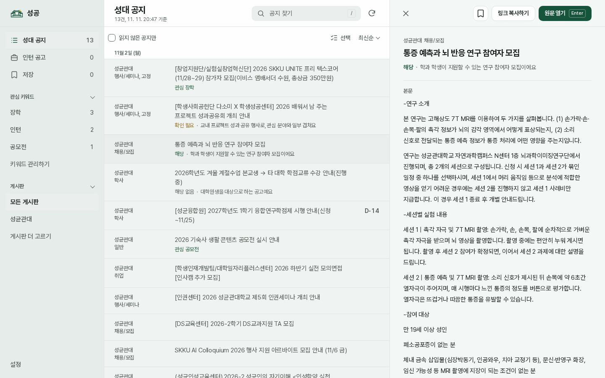
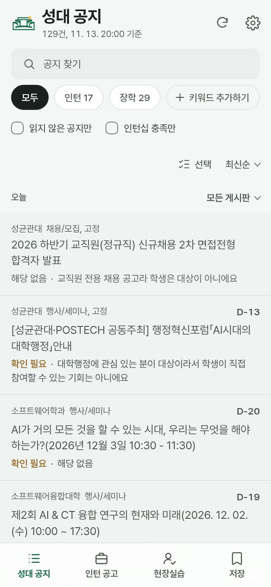
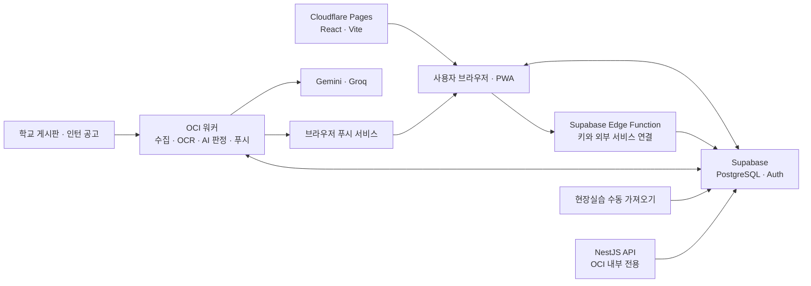

# 성공

성균관대 공지와 인턴 공고를 모아 보고, 관심 있는 소식을 놓치지 않도록 돕는 웹 앱입니다. 게시판과 키워드를 고르고 저장한 공지를 기기 간에 확인할 수 있습니다.

**[성공 열기](https://skku-notice-platform.pages.dev/)** · [개인정보 처리방침](https://skku-notice-platform.pages.dev/privacy.html) · [문의하기](https://github.com/aniseongu/skku-notice-platform/issues)

## 주요 기능

- **공지 모아 보기** — 성균관대와 학과 게시판, 외부 인턴 공고, 현장실습 정보를 검색하고 저장합니다.
- **내게 맞는 알림** — 구독한 게시판과 관심 키워드를 바탕으로 웹 푸시 알림을 받습니다.
- **AI 공지 확인** — 직접 연결한 Gemini 또는 Groq 키로 공지의 관련성과 요약을 확인합니다. 인턴십 졸업요건 확인도 지원합니다.
- **일정 연동** — 아이캠퍼스 과제·퀴즈 알림과 저장한 공지의 Google 캘린더 동기화를 선택할 수 있습니다.
- **기기 간 사용** — Google 로그인으로 구독·키워드·저장·읽음 상태를 동기화하고, 모바일 홈 화면에 앱으로 추가할 수 있습니다.

처음 사용할 때 Google 로그인, 전공과 AI 키 설정이 필요합니다. AI 판단과 인턴십 요건 안내는 참고용이며, 최종 인정 여부는 학교와 학과에 확인해야 합니다.

## 화면

| PC | 모바일 |
| :---: | :---: |
|  |  |

화면은 2026년 11월에 촬영한 예시입니다.

## 구성



OCI에서는 아이캠퍼스와 Google 캘린더 동기화도 처리합니다. NestJS API는 서버 내부에서만 실행되며, 웹 앱의 공개 API로 연결되어 있지는 않습니다. 사용자 데이터는 Supabase RLS로 분리하고 AI 키와 외부 서비스 토큰은 암호화해 보관합니다.

## 로컬 실행

Node.js 22.12 이상과 Python 3.12 이상을 사용합니다. 인증 설정 없이 예시 공지로 화면을 확인할 수 있습니다.

```sh
cd web
npm ci
VITE_SUPABASE_URL= VITE_SUPABASE_PUBLISHABLE_KEY= npm run dev -- --host 127.0.0.1
```

브라우저에서 `http://127.0.0.1:5173/?api=sample/api/v1`을 엽니다. 실제 인증을 연결하려면 [환경 변수 예시](web/.env.example)를 참고해 `web/.env.local`에 Supabase URL과 publishable 키를 설정하세요. 관리자 키는 웹 환경 변수에 넣지 않습니다.

```sh
# 웹 테스트와 빌드 (web/)
npm test
npm run test:e2e
npm run build

# Python 테스트 (저장소 루트, uv 필요)
uv run pytest -q
uv run ruff check src tests
```

## 저장소 구조

| 경로 | 내용 |
| --- | --- |
| `web/` | React 웹 앱과 PWA |
| `apps/api/` | NestJS 내부 API |
| `src/skku_notice/` | 공지 수집·OCR·판정·알림 워커 |
| `supabase/` | DB 마이그레이션과 Edge Function |
| `infra/oracle/` | OCI 서비스와 타이머 설정 |

운영 DB는 초기 마이그레이션을 수동 적용해 CLI 이력이 완전하지 않습니다. 운영 환경에 `supabase db push`를 사용하지 않습니다.

## 참고 사항

- 현장실습 정보는 운영자가 학교에 직접 로그인해 가져오며 자동 갱신되지 않습니다. 공지와 현장실습 정보는 로그인한 사용자에게만 표시되지만, 학교 구성원 여부를 별도로 확인하지는 않습니다.
- 수동 테스트 푸시는 확인했지만 새 공지 자동 푸시의 전체 경로와 장기 부하는 계속 검증하고 있습니다. 모바일 브라우저별 실제 앱 설치 동작도 추가 확인이 필요합니다.
- 외부 공고와 현장실습 수집에는 각 사이트의 이용 조건과 접근 정책에 따른 제약이 있습니다.
- 기존 [개인용 성공](https://github.com/aniseongu/skku-notice-alert)과는 별도로 운영하는 프로젝트입니다.
