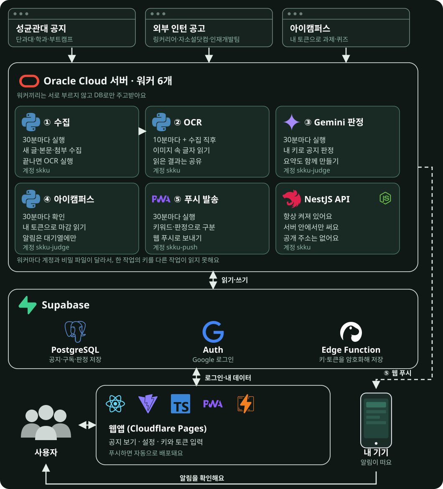

<div align="center">


# 성공

성균관대 공지와 인턴 공고를 모아 보고, 나에게 맞는 공지만 알림으로 받는 다중 사용자 웹 앱


[](https://skku-notice-platform.pages.dev/)

</div>

기존 [개인용 성공](https://github.com/aniseongu/skku-notice-alert)의 화면 구조와 알림 규칙을 로그인한 여러 사용자가 각자 쓰도록 옮긴 공지 플랫폼입니다. 위 버튼의 Cloudflare Pages 주소는 **시험 중인 사이트**이며 아직 정식 서비스가 아닙니다. 기본 알림 수신 경로와 장기 부하는 계속 검증하고 있습니다.

## 할 수 있는 것

- **공지 보기**: 성균관대 공지, 단과대학·학과 게시판(60여 개), 부트캠프, 외부 인턴 공고(링커리어, 자소설닷컴, 학생인재개발팀)를 한곳에서 봅니다. 게시판은 로그인한 사용자가 고른 것만 수집합니다.
- **첫 로그인 설정**: 주전공과 복수전공, 학년과 재학 상태, 전공과 상관없는 게시판, 받을 공지, 알림을 순서대로 고릅니다.
- **공지 읽기**: 검색, 최신순·마감순 정렬, 읽지 않은 글 보기, 선택한 공지나 현재 목록의 읽음 표시, 저장한 공지 모아 보기를 지원합니다. 관심 키워드에는 현재 보기에서 키워드에 맞는 글 수를 보여 주고, 마감이 있는 공지와 인턴 공고에는 마감을 표시합니다. 키보드로 J·K(이동), S(저장), Enter(원문), Esc(닫기)를 쓸 수 있습니다.
- **공지 상세**: 본문, 그림 속 글자(OCR로 읽은 글), 첨부 파일, 원문 열기를 한 화면에서 봅니다. 학교가 제목이나 본문을 고친 글에는 고친 날짜를 표시하고, 본문이 아직 없으면 원문으로 바로 갈 수 있게 안내합니다.
- **알림**: 웹 푸시(VAPID)로 새 공지를 보냅니다. 관심 키워드가 맞는 공지는 소리로, 나머지는 조용히 보내고 학교가 고친 중요한 글은 한 번 더 알립니다.
- **기기별 알림 관리**: 이 기기의 알림을 직접 켜고 끄며, 테스트 알림으로 도착하는 모습을 확인합니다. 로그아웃하면 이 기기의 알림 등록을 해제하고 계정이 바뀌면 이전 계정의 기기 구독을 정리합니다. 키워드는 설정에서 바로 추가·삭제하고 계정에 순서대로 저장합니다.
- **화면과 설치**: 라이트·다크·자동 모드, 앱 설치(PWA), 성대 공지 탭에 "모든 게시판"이나 "받는 게시판만" 보기를 고를 수 있습니다. 서버 연결에 실패하면 마지막 공지 스냅샷을 보여 줍니다.
- **내 Gemini 키(선택)**: 사용자가 직접 넣은 키로 성대 공지와 인턴 공고가 나에게 맞는지 판정해, 맞는 공지를 소리로 알립니다. 키는 암호화해 서버에만 보관하며 브라우저가 읽을 수 없습니다.
- **아이캠퍼스 토큰(선택)**: 사용자가 직접 만든 아이캠퍼스(Canvas) 토큰으로 마감이 가까운 과제와 퀴즈를 알립니다. 토큰은 Gemini 키와 같은 방식으로 보호합니다.
- **프로필 설정**: 전공, 학년, 재학 상태, 병역과 관심 분야(주관식)를 바꿉니다. Gemini 판정에만 쓰이며 이름, 학번, 연락처는 받지 않습니다.
- 구독, 키워드, 저장, 읽음은 계정별로 DB에 저장하고 행 수준 보안(RLS)으로 사용자 간 접근을 막습니다. 저장·읽음의 화면 동기화는 계속 검증하고 있습니다.

## 시스템 아키텍처



## 왜 서버리스가 아니라 서버를 쓰나

짧게 요청을 받아 바로 답하는 일은 서버리스(Cloudflare Pages, Supabase Edge Function)에 맡기고, 오래 도는 일괄 작업은 Oracle Cloud의 서버 한 대에서 systemd 타이머로 돌립니다.

- **OCR이 오래 걸리고 무겁습니다.** RapidOCR(onnxruntime)이 긴 포스터 한 장을 읽는 데 약 105초, 메모리 약 500MiB가 들었습니다. 요청마다 시간과 메모리 한도가 있는 서버리스 함수보다, 모델 파일을 디스크에 두고 엔진을 한 번 올려 여러 장을 이어서 처리하는 쪽이 맞습니다.
- **수집은 천천히, 순서대로 해야 합니다.** 학교 게시판에는 요청 사이에 1.5초 이상 간격을 두고, 외부 사이트는 시간당 한 번만 읽습니다. 이런 속도 조절과 중복 실행 방지(`flock`)는 하나의 오래 사는 프로세스에서 다루기 쉽습니다.
- **비밀의 범위를 나눌 수 있습니다.** 작업별 시스템 사용자와 환경 파일로 나눠 실행합니다. 사용자 키를 복호화하는 작업(Gemini 판정, 아이캠퍼스 확인)과 푸시 비밀키를 가진 작업(푸시 발송)은 서로의 키 파일을 읽을 수 없게 했습니다.
- **무거운 Python 의존성을 그대로 씁니다.** OCR 엔진과 이미지 처리 라이브러리는 서버리스 배포 크기 한도를 넘기기 쉽습니다.
- **운영에 필요한 도구가 기본으로 있습니다.** systemd가 타이머, 메모리·CPU 제한, 재시작, 로그(journald)를 한곳에서 맡습니다.

서버 한 대에 의존하는 만큼 장애에 약합니다. 재부팅 뒤 복구와 부하가 큰 상황은 아직 검증하지 못했습니다(아래 "알려진 한계").

## 기술 구성

[](https://www.python.org/)
[](https://www.typescriptlang.org/)
[](https://react.dev/)
[](https://vite.dev/)
[](https://nestjs.com/)
[](https://nodejs.org/)
[](https://supabase.com/)
[](https://www.postgresql.org/)
[](https://ai.google.dev/)
[](https://skku-notice-platform.pages.dev/)
[](https://www.oracle.com/cloud/free/)
[](https://playwright.dev/)
[](https://github.com/aniseongu/skku-notice-platform/actions)

## 로컬 확인

```sh
cd web
npm ci
npm test            # 단위 테스트(Node), Supabase 정책·함수는 PGlite로 검증
npm run test:e2e    # Playwright(데스크톱·모바일)
npm run build
npm run dev -- --host 127.0.0.1
```

샘플 공지는 개발 서버 URL에 `?api=sample/api/v1`을 붙여 볼 수 있습니다. 샘플은 실제 사용자 데이터가 아닙니다. Python 테스트와 린트는 프로젝트 루트에서 실행합니다.

```sh
uv run pytest -q
uv run ruff check src tests
```

## 인증 설정

`web/.env.example`을 `web/.env.local`로 복사하고 Supabase 프로젝트 URL과 **publishable** 키를 입력합니다. 이 값은 빌드 결과에 공개되므로 secret 또는 service-role 키를 넣지 않습니다. OAuth 복귀 주소는 Supabase 허용 목록에 추가해야 합니다.

## 데이터와 마이그레이션

테이블, 함수, RLS 정책은 `supabase/migrations/`에 있습니다. 지금은 SQL Editor로 순서대로 적용하며 Supabase CLI 마이그레이션 이력에는 자동으로 등록되지 않습니다. 새 환경에서는 파일 이름 순서대로 적용하세요. 키와 토큰의 암호문 열은 서비스 역할만 읽을 수 있습니다(`supabase/functions/byok/`).

수집 워커의 `SUPABASE_SECRET_KEY`, 푸시 `VAPID_PRIVATE_KEY`, 키 암호화용 `BYOK_MASTER_KEY`는 서버의 제한된 환경 파일에만 두고 프론트 환경 변수와 로그에 넣지 않습니다. 비밀과 개인 데이터는 커밋하지 않습니다.

## 수집하는 게시판 목록

수집하는 단과대학·학과 게시판은 `scripts/board_catalog.py` 한 파일에 모아 두고, 여기서 서버 설정(`config/sources.yaml`)과 웹의 게시판 목록(`web/src/skku-boards.ts`)을 함께 만듭니다. 게시판을 더하거나 고칠 때는 이 파일만 바꾼 뒤 `generate`로 다시 만들고, `verify`로 모든 게시판이 실제로 읽히는지 확인합니다. 로그인이 필요하거나 읽지 못한 게시판은 넣지 않았고, 정해 둔 주소 외의 임의 주소는 수집하지 않습니다.

## 알려진 한계

- 서버가 보낸 푸시가 새 공지에서 자동으로 기기까지 도착하는 전체 경로, 아이캠퍼스 알림 도착은 계속 관찰하고 있습니다. 발송 뒤 상태를 기록하기 전에 장애가 나면 알림이 한 번 더 갈 수 있습니다.
- 외부 인턴 공고 수집은 해당 사이트의 이용약관과 robots.txt 정책을 따로 확인해야 하며, 운영자가 위험을 알고 켠 기능입니다.
- 1GB 서버에서 OCR이 긴 이미지를 처리하는 데 시간이 걸립니다. 부하가 큰 상황의 안정성은 검증하지 않았습니다.
- 사범대학, 약학대학, 의과대학 등 일부 학과 게시판은 로그인이 필요하거나 읽지 못해 목록에 없습니다.
- 개인용 서비스의 캘린더 연동과 RSS 피드는 옮기지 않았습니다.
