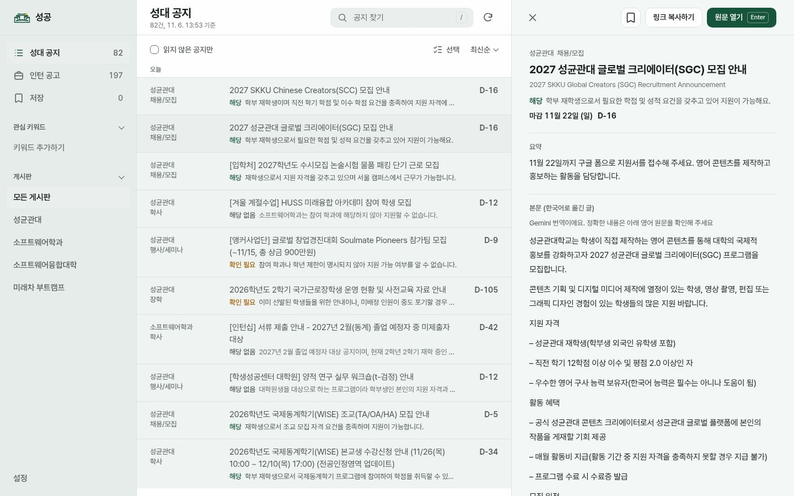
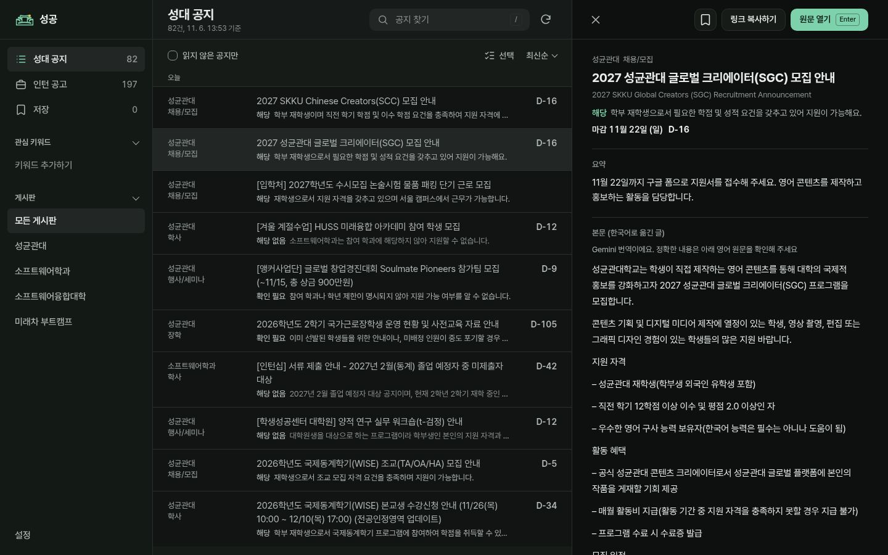
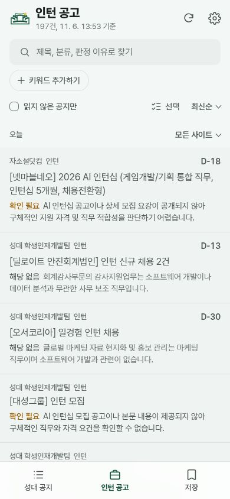
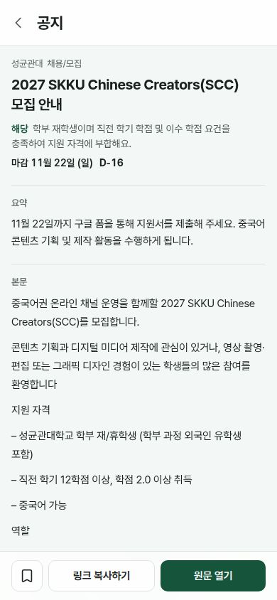
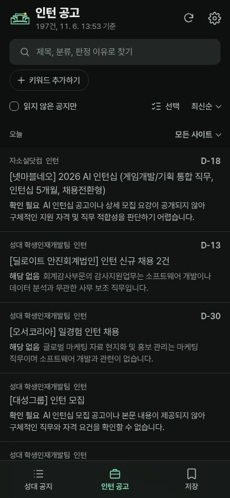
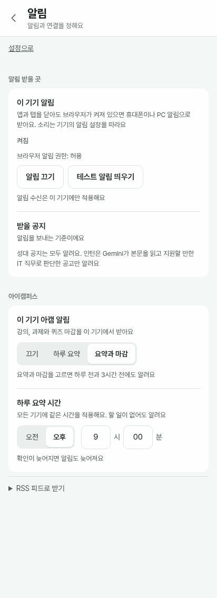
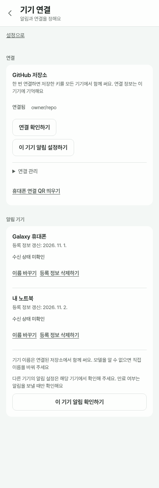

<div align="center">


# 성공

성균관대 공지와 인턴 공고를 모아 보고, 해야 할 일을 챙기는 설치형 웹 앱


[](https://aniseongu.github.io/skku-notice-alert/)

</div>

## 사용 화면

PC에서는 목록과 공지 상세를 함께 봅니다. 상세가 열린 공지를 다시 누르면 오른쪽 상세 칸을 닫을 수 있습니다.

| PC 웹 브라우저 | PC 앱 창 |
|---|---|
|  |  |

휴대폰에서는 인턴 공고를 살펴보고 공지를 눌러 상세와 원문을 확인합니다.

| 모바일 웹: 인턴 공고 | 모바일 웹: 공지 상세 | 모바일 크기 앱 화면 |
|---|---|---|
|  |  |  |

설정에서는 이 브라우저의 알림 권한과 아캠 알림 범위를 고르고, 등록된 알림 기기를 확인할 수 있습니다. 두 화면은 연결 상태와 기기 목록을 예시 데이터로 캡처했습니다.

| 알림 설정 | 알림 기기 예시 |
|---|---|
|  |  |

## 주요 기능

- 성균관대 공지와 인턴 공고를 게시판별로 살펴보고, 관심 있는 글을 저장할 수 있습니다.
- 검색, 최신순과 마감순 정렬, 읽지 않은 글 보기와 선택한 공지 또는 현재 목록의 읽음 표시를 지원합니다. 관심 키워드에는 현재 보기에서 키워드에 맞는 글 수를 표시합니다.
- 공지 본문과 이미지, 학교 공지의 Gemini 요약, 번역을 확인하고 원문을 열 수 있습니다. 요약과 본문이 준비되지 않은 글은 원문에서 확인할 수 있습니다.
- 새로운 공지와 인턴 공고를 기기별 웹 푸시로 받고, 저장한 글의 일정을 구글 캘린더에 모을 수 있습니다.
- 아이캠퍼스를 연결하면 과제, 퀴즈와 미완료 강의 마감과 하루 요약을 받을 수 있습니다. 요약 시간은 설정에서 바꿀 수 있습니다.
- 앱 설치, 라이트와 다크 모드, 키보드 탐색, 오프라인 목록을 지원합니다.

학교 공지는 30분마다 확인을 시도하고, 인턴 공고는 마지막 성공 확인 후 1시간이 지나면 다음 실행에서 확인합니다. 인턴 공고는 Gemini로 직무와 지원 가능성을 판단하며, 판정에 필요한 정보가 없으면 확인을 기다립니다. 수집 결과는 GitHub Actions 실행 상황에 따라 늦어질 수 있습니다.

## 수집 출처

| 화면 | 출처 |
|---|---|
| 성대 공지 | [성균관대 공지](https://www.skku.edu/skku/campus/skk_comm/notice01.do), [소프트웨어학과](https://cse.skku.edu/cse/notice.do), [소프트웨어융합대학](https://sw.skku.edu/sw/notice.do), [미래차 부트캠프](https://swb.skku.edu/futurecar/notice.do) |
| 인턴 공고 | [성대 학생인재개발팀](https://job.skku.edu/Recruit/RecruitInternList.aspx?rp=1), [링커리어](https://linkareer.com/list/intern), [자소설닷컴](https://jasoseol.com/recruit) |

인턴 공고는 Gemini가 지원할 만한 IT 직무라고 판정한 경우 알림을 보냅니다. 학생인재개발팀의 첨부 문서는 링크를 제공하며 문서 내용 자체는 자동으로 읽지 않습니다. 목록에 마감 날짜만 있는 경우 해당 날짜의 23:59로 표시하므로 정확한 시각은 원문에서 확인해 주세요.

## 기술 구성

[](https://www.python.org/)
[](https://www.typescriptlang.org/)
[](https://lit.dev/)
[](https://vite.dev/)
[](https://ai.google.dev/)
[](https://github.com/aniseongu/skku-notice-alert/actions)
[](https://aniseongu.github.io/skku-notice-alert/)

| 영역 | 사용 기술 |
|---|---|
| 수집과 파싱 | Python, httpx, selectolax, nh3 |
| 판정과 요약 | Google Gen AI SDK, Gemini 본문 및 이미지 판정. 키가 없으면 인턴 판정 대기 |
| 이미지 글자 인식 | RapidOCR, ONNX Runtime |
| 화면 | TypeScript, Lit, Vite, Pretendard |
| 설치와 오프라인 | vite-plugin-pwa, Workbox |
| 알림 | pywebpush, Apprise |
| 실행과 배포 | uv, GitHub Actions, GitHub Pages |

공개 게시판에서 받은 글을 파싱하고 중복을 걸러 기준을 적용한 뒤 알림과 정적 API를 만듭니다. 화면은 이 API를 읽습니다.

## 내 저장소에서 실행하기

1. 저장소를 준비하고 `Settings > Pages > Build and deployment > Source`를 **GitHub Actions**로 설정합니다. 워크플로마다 필요한 권한을 선언하므로 저장소 전체의 기본 권한을 넓힐 필요는 없습니다.
2. `Settings > Secrets and variables > Actions`에서 필요한 값을 등록합니다. Pages가 열린 뒤에는 앱 설정에서 저장소를 연결해 키와 관심 키워드를 넣을 수도 있습니다.
3. `Actions > Publish website > Run workflow`로 화면을 배포합니다. 알림 키가 없어도 공개 화면을 배포할 수 있습니다.
4. `Actions > Check overseas access > Run workflow`로 공개 게시판과 Canvas의 접근 상태를 확인합니다.
5. `Actions > Notice and Pages > Run workflow`로 수집을 시작합니다. 게시판별 첫 실행에는 현재 글을 저장하고 알림을 보내지 않습니다.
6. 앱 설정의 **이 기기 알림**에서 휴대폰과 노트북을 각각 연결합니다. 웹 푸시는 최대 8대까지 등록합니다.

| 종류 | 이름 | 용도 |
|---|---|---|
| Secret | `WEB_PUSH_PRIVATE_KEY` | 웹 푸시 발송용 VAPID 비밀키. 대응 공개키는 `web/public/web-push.json`에 둡니다. |
| Secret, 앱이 저장 | `WEB_PUSH_SUB_1`부터 `WEB_PUSH_SUB_8` | 기기별 알림 구독 정보 |
| Secret, 선택 | `GEMINI_API_KEY` | Gemini 판정, 요약과 번역 |
| Secret, 선택 | `PROFILE_YAML` | 개인 프로필. 파일 대신 Secret에 넣습니다. |
| Secret, 선택 | `CANVAS_TOKEN` | 아이캠퍼스 개인 액세스 토큰 |
| Secret, 선택 | `GOOGLE_CLIENT_SECRET`, `GOOGLE_REFRESH_TOKEN` | 구글 캘린더 연결 |
| Secret, 앱이 저장 | `GOOGLE_CONNECTION` | 구글 캘린더 연결 정보. 기존 개별 Secret보다 우선하며 하나로 저장합니다. |
| Secret, 선택 | `NOTIFY_URLS` | Apprise 추가 알림 경로 |
| Variable, 앱이 저장 | `INTEREST_KEYWORDS`, `MUTED_CATEGORIES` | 관심 키워드와 끈 분류 |
| Variable, 앱이 저장 | `PUSH_DEVICE_NAME_1`부터 `PUSH_DEVICE_NAME_8`, `PUSH_DEVICE_NAME_LEGACY` | 기기별 표시 이름. 구독 주소와 키는 포함하지 않습니다. |
| Variable, 앱이 저장 | `SAVED_NOTICES`, `READ_NOTICES` | 저장한 글과 읽음 상태 |

GitHub 연결 토큰은 이 저장소 하나에만 접근하는 Fine-grained token을 사용합니다. Secrets와 Variables에 읽기 및 쓰기 권한을 부여합니다. 앱의 수동 수집 버튼을 사용하려면 Actions 읽기 및 쓰기 권한도 필요합니다. 기기 연결 QR에는 토큰이 포함됩니다. 기기 이름은 저장소의 Actions 변수에 저장되므로 변수 읽기 권한이 있는 사용자와 워크플로가 볼 수 있습니다. 각 기기의 브라우저가 모델을 제공하면 이름으로 제안하며, 확인 후 저장해야 다른 기기에서도 보입니다. 기존에 등록된 다른 기기의 모델은 복원할 수 없습니다.

## 연결과 실패 복구

연결 흐름은 입력, 확인, 저장, 실제 사용 단계를 순서대로 분리합니다. 각 단계는 성공 여부를 확인하고, 실패하면 입력과 기존 연결을 가능한 한 보존해 다시 시도합니다. Secret은 저장 후 값을 다시 읽을 수 없으므로 서버가 저장한 뒤 응답만 유실된 경우에는 결과를 단정하지 않습니다.

| 연결 | 현재 동작 | 실패 후 복구 |
|---|---|---|
| GitHub | 저장소의 Secret 목록으로 접근을 확인한 뒤 연결 토큰을 이 기기에 암호화해 기억합니다. | 확인 실패를 표시하고 다시 연결할 수 있습니다. 다른 설정 동기화의 실패 단계부터 재개하는 체인은 아직 없습니다. |
| Gemini | GitHub 접근, Gemini 키 확인, Secret 저장을 순서대로 실행합니다. 일시 오류와 거절을 구분합니다. | 같은 입력을 유지한 채 다시 시도하면 이 탭에서 성공한 단계를 반복하지 않습니다. |
| 아이캠퍼스 | GitHub 접근을 확인한 뒤 토큰을 Secret 하나에 저장합니다. 실제 토큰은 다음 수집 실행에서 Canvas와 LearningX로 확인합니다. | 같은 입력을 유지한 채 다시 시도하면 이 탭에서 성공한 저장 준비 단계를 반복하지 않습니다. 수집이나 발송 실패는 이후 실행에서 재시도합니다. |
| Google 캘린더 | 승인, 기존 캘린더 확인, 생성, 연결 정보 저장을 순서대로 실행합니다. 자격 정보와 캘린더 ID는 하나의 Secret으로 저장합니다. | 열린 탭에서는 성공한 단계를 건너뛰고 실패한 단계부터 재시도합니다. 탭을 닫으면 다시 승인해야 하며 생성한 캘린더 ID는 저장 전까지 이 기기에 기억합니다. |
| 브라우저 알림 | 브라우저 권한과 구독을 확인하고 기기별 Secret에 저장합니다. | 저장 또는 해제가 실패하면 다시 시도할 수 있습니다. 기존 구독 주소는 다른 기기에서 읽을 수 없습니다. |

Canvas는 학교 서버가 브라우저의 교차 출처 요청을 허용하지 않아 저장 전에 토큰의 유효성을 확인하지 않습니다. 저장 완료는 실제 인증 성공을 뜻하지 않습니다. 기존 토큰을 바꾸면 다음 수집에서 새 토큰을 확인합니다. 수집 중 토큰 거절 응답은 같은 요청을 한 번 더 확인하며, 두 번 거절될 때 토큰 교체를 안내합니다. 연결 오류와 서버 오류를 포함한 요청은 합쳐서 최대 세 번만 시도합니다.

공통 체인 설계 기준은 다음과 같습니다.

1. 입력을 검증하고, 외부 서비스 인증과 기존 설정 조회를 각각 별도 단계로 둡니다. 일시적인 통신 실패와 거절을 구분해 원인과 다음 행동을 보여 줍니다.
2. 모든 필수 값이 준비되면 기존 연결을 대체합니다. 함께 바뀌어야 하는 비밀은 하나의 Secret으로 저장합니다. 성공한 단계를 반복할 때 중복 생성이나 기존 설정 손상이 없도록 합니다.
3. 실패한 단계와 재시도 방법을 표시합니다. 현재 Google, Gemini와 Canvas 키 저장 체인은 탭의 메모리에서만 진행 상태를 보존합니다. 탭 종료 후 재개는 구현과 검증이 더 필요합니다.
4. 토큰, 구독 주소, 인증 응답은 로그와 문서, 공개 사이트에 기록하지 않습니다. 재시도 상태에도 비밀을 평문으로 영구 저장하지 않습니다.
5. 테스트에서는 각 단계의 실패, 응답 유실, 재시도와 기존 설정 보존을 확인합니다. 실제 인증 성공과 실제 알림 수신은 별도로 검증합니다.

## 개인정보와 보안

이 프로젝트의 공개 사이트에는 공지와 함께 개인화된 판정 결과가 표시됩니다. 데이터 공개 범위, 선택 기능에 필요한 정보, 보관과 삭제 방법은 [개인정보 처리 안내](PRIVACY.md)를 참고하세요.

## 로컬 개발

Python 3.12 이상, uv와 Node.js가 필요합니다.

```sh
uv sync --frozen
cp config/rules.example.yaml config/rules.yaml
uv run skku-notice --dry-run --all --no-canvas
scripts/check.sh
```

`--dry-run`은 알림을 보내거나 상태를 저장하지 않고 결과만 보여줍니다.

```sh
cd web
npm ci
npm run dev
npm run build
npm test
```

개발 서버는 `localhost`에서 실행됩니다.
