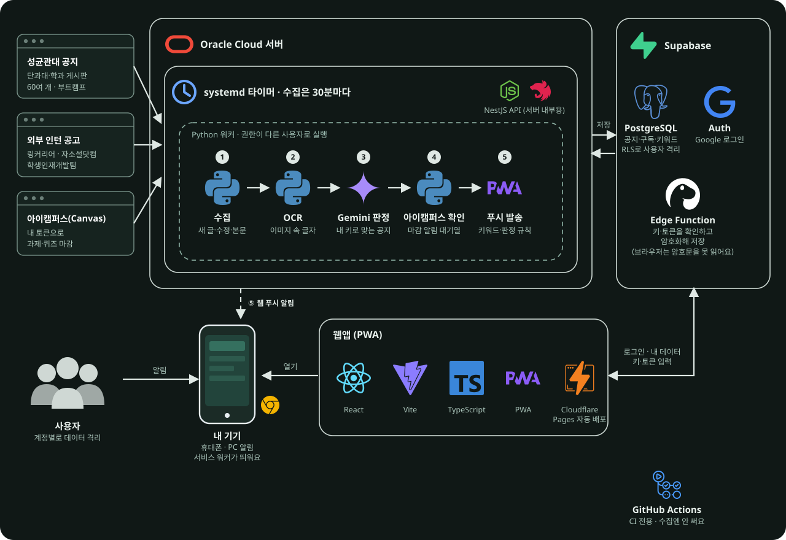

<div align="center">


# 성공

성균관대 공지와 인턴 공고를 모아 보고, 나에게 맞는 공지만 알림으로 받는 다중 사용자 웹 앱


[](https://skku-notice-platform.pages.dev/)

</div>

기존 [개인용 성공](https://github.com/aniseongu/skku-notice-alert)의 화면 구조와 알림 규칙을 로그인한 여러 사용자가 각자 쓰도록 옮긴 공지 플랫폼입니다. 위 버튼의 Cloudflare Pages 주소는 **시험 중인 사이트**이며 아직 정식 서비스가 아닙니다. 기본 알림 수신 경로와 장기 부하는 계속 검증하고 있습니다.

## 할 수 있는 것

- **공지 보기**: 성균관대 공지, 단과대학·학과 게시판(60여 개), 부트캠프, 외부 인턴 공고(링커리어, 자소설닷컴, 학생인재개발팀)를 한곳에서 봅니다. 게시판은 로그인한 사용자가 고른 것만 수집합니다.
- **첫 로그인 설정**: 주전공과 복수전공, 학년과 재학 상태, 전공과 상관없는 게시판, 받을 공지, 알림을 순서대로 고릅니다.
- **알림**: 웹 푸시(VAPID)로 새 공지를 보냅니다. 관심 키워드가 맞는 공지는 소리로, 나머지는 조용히 보내고 학교가 고친 중요한 글은 한 번 더 알립니다.
- **내 Gemini 키(선택)**: 사용자가 직접 넣은 키로 성대 공지와 인턴 공고가 나에게 맞는지 판정해, 맞는 공지를 소리로 알립니다. 키는 암호화해 서버에만 보관하며 브라우저가 읽을 수 없습니다.
- **아이캠퍼스 토큰(선택)**: 사용자가 직접 만든 아이캠퍼스(Canvas) 토큰으로 마감이 가까운 과제와 퀴즈를 알립니다. 토큰은 Gemini 키와 같은 방식으로 보호합니다.
- **프로필 설정**: 전공, 학년, 재학 상태, 병역과 관심 분야(주관식)를 바꿉니다. Gemini 판정에만 쓰이며 이름, 학번, 연락처는 받지 않습니다.
- 저장, 읽음, 키워드, 구독은 계정별로 DB에 저장하고 행 수준 보안(RLS)으로 사용자 간 접근을 막습니다.

## 시스템 아키텍처



1. OCI 서버의 타이머가 30분마다 학교 게시판과 외부 인턴 공고를 읽어 Supabase에 저장하고, 첨부 이미지는 OCR로 글자를 뽑습니다.
2. 사용자가 Gemini 키를 넣었다면 그 키로 나에게 맞는 공지인지 판정하고, 아이캠퍼스 토큰이 있으면 마감이 가까운 과제를 알림 대기열에 넣습니다.
3. 푸시 워커가 관심 키워드와 판정 결과에 따라 소리 또는 무음으로 웹 푸시를 보냅니다.
4. 웹앱은 Supabase에서 자기 계정의 데이터만 읽습니다. 키와 토큰은 Edge Function이 확인하고 암호화해 저장하며, 복호화는 서버의 해당 워커만 합니다.

## 기술 구성

[](https://www.python.org/)
[](https://www.typescriptlang.org/)
[](https://react.dev/)
[](https://vite.dev/)
[](https://nestjs.com/)
[](https://nodejs.org/)
[](https://supabase.com/)
[](https://www.postgresql.org/)
[](https://ai.google.dev/)
[](https://skku-notice-platform.pages.dev/)
[](https://www.oracle.com/cloud/free/)
[](https://playwright.dev/)
[](https://github.com/aniseongu/skku-notice-platform/actions)

| 영역 | 기술 |
|---|---|
| 웹 | React, TypeScript, Vite, PWA(Workbox), Cloudflare Pages(푸시하면 자동 배포) |
| 인증·DB | Supabase Auth(Google), PostgreSQL, RLS, Edge Function(`byok`) |
| 서버 API | NestJS(서버 내부용, 공개 HTTPS 주소는 아직 없음) |
| 수집·OCR·알림 | Python, systemd 타이머(OCI 무료 Micro), RapidOCR(한국어 ONNX) |

OCI의 타이머는 수집(30분), OCR, Gemini 판정, 아이캠퍼스 확인, 푸시 발송으로 나뉘며 권한이 다른 사용자로 실행합니다. GitHub Actions는 CI에만 씁니다.

## 로컬 확인

```sh
cd web
npm ci
npm test            # 단위 테스트(Node), Supabase 정책·함수는 PGlite로 검증
npm run test:e2e    # Playwright(데스크톱·모바일)
npm run build
npm run dev -- --host 127.0.0.1
```

샘플 공지는 개발 서버 URL에 `?api=sample/api/v1`을 붙여 볼 수 있습니다. 샘플은 실제 사용자 데이터가 아닙니다. Python 테스트와 린트는 프로젝트 루트에서 실행합니다.

```sh
uv run pytest -q
uv run ruff check src tests
```

## 인증 설정

`web/.env.example`을 `web/.env.local`로 복사하고 Supabase 프로젝트 URL과 **publishable** 키를 입력합니다. 이 값은 빌드 결과에 공개되므로 secret 또는 service-role 키를 넣지 않습니다. OAuth 복귀 주소는 Supabase 허용 목록에 추가해야 합니다.

## 데이터와 마이그레이션

테이블, 함수, RLS 정책은 `supabase/migrations/`에 있습니다. 지금은 SQL Editor로 순서대로 적용하며 Supabase CLI 마이그레이션 이력에는 자동으로 등록되지 않습니다. 새 환경에서는 파일 이름 순서대로 적용하세요. 키와 토큰의 암호문 열은 서비스 역할만 읽을 수 있습니다(`supabase/functions/byok/`).

수집 워커의 `SUPABASE_SECRET_KEY`, 푸시 `VAPID_PRIVATE_KEY`, 키 암호화용 `BYOK_MASTER_KEY`는 서버의 제한된 환경 파일에만 두고 프론트 환경 변수와 로그에 넣지 않습니다. 비밀과 개인 데이터는 커밋하지 않습니다.

## 게시판 카탈로그

`scripts/board_catalog.py`가 게시판 목록 한 곳에서 `config/sources.yaml`과 `web/src/skku-boards.ts`를 만듭니다. `generate`로 다시 만들고 `verify`로 모든 게시판을 수집 파서로 확인합니다. 로그인이 필요하거나 파서가 읽지 못한 게시판은 넣지 않았습니다. 임의 URL은 수집하지 않습니다.

## 알려진 한계

- 서버가 보낸 푸시가 새 공지에서 자동으로 기기까지 도착하는 전체 경로, 아이캠퍼스 알림 도착은 계속 관찰하고 있습니다. 발송 뒤 상태를 기록하기 전에 장애가 나면 알림이 한 번 더 갈 수 있습니다.
- 외부 인턴 공고 수집은 해당 사이트의 이용약관과 robots.txt 정책을 따로 확인해야 하며, 운영자가 위험을 알고 켠 기능입니다.
- 1GB 서버에서 OCR이 긴 이미지를 처리하는 데 시간이 걸립니다. 부하가 큰 상황의 안정성은 검증하지 않았습니다.
- 사범대학, 약학대학, 의과대학 등 일부 학과 게시판은 수집하지 못해 카탈로그에 없습니다.
- 개인용 서비스의 캘린더 연동과 RSS 피드는 옮기지 않았습니다.
