<div align="center">


# 성공

성균관대 공지와 인턴 공고를 모아 보고, 나에게 맞는 공지만 알림으로 받는 다중 사용자 웹 앱


[](https://pages.cloudflare.com/)

[](https://skku-notice-platform.pages.dev/)

</div>

기존 [개인용 성공](https://github.com/aniseongu/skku-notice-alert)의 화면 구조와 알림 규칙을 로그인한 여러 사용자가 각자 쓰도록 옮긴 공지 플랫폼입니다. 웹은 Cloudflare Pages에서 서비스합니다. 새 공지가 올라왔을 때의 자동 알림 수신과 장기 부하는 계속 검증하고 있습니다.

## 사용 화면

### PC

목록과 공지 상세를 함께 봅니다. 목록에는 관심 키워드와 내 AI 판정 이유, 마감 D-day가 보이고, 공지를 누르면 오른쪽에 판정 이유와 본문이 열립니다. 열린 공지를 다시 누르면 상세 칸이 닫힙니다.

**라이트**

<p align="center">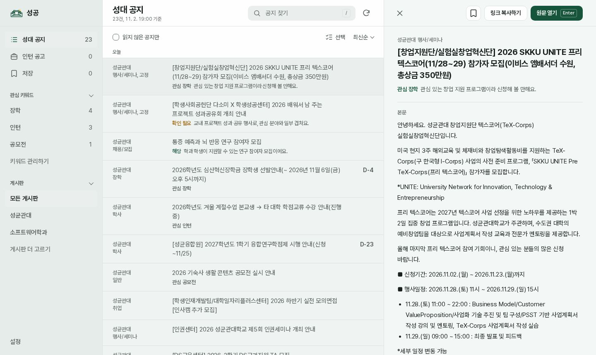</p>

**다크**

<p align="center">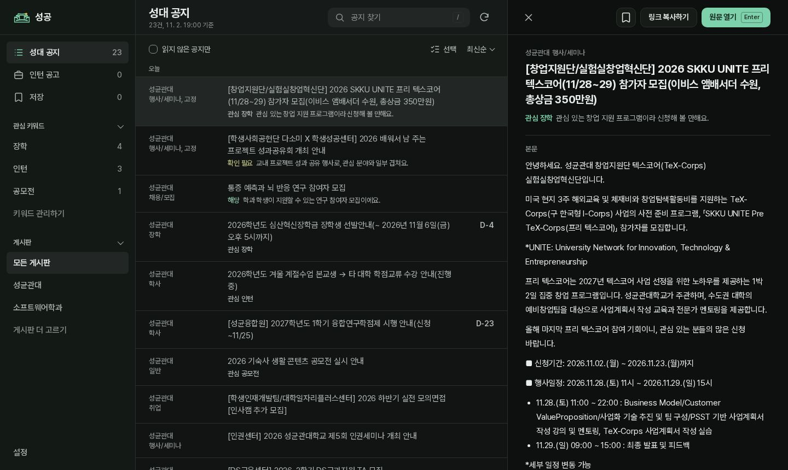</p>

### 모바일

아래 탭으로 성대 공지, 인턴 공고, 저장한 공지를 오가고, 공지를 눌러 상세와 원문을 확인합니다.

| 공지 목록: 라이트 | 공지 목록: 다크 |
|:---:|:---:|
| 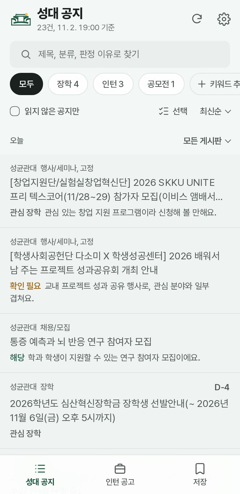 | 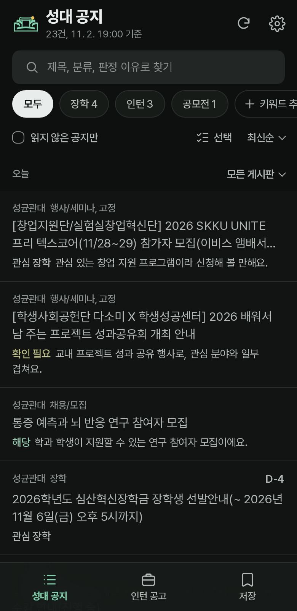 |

| 공지 상세: 라이트 | 공지 상세: 다크 |
|:---:|:---:|
| 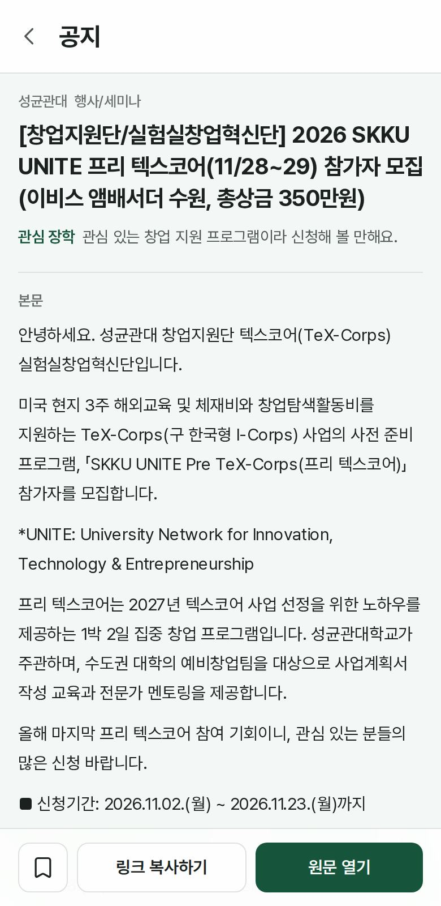 | 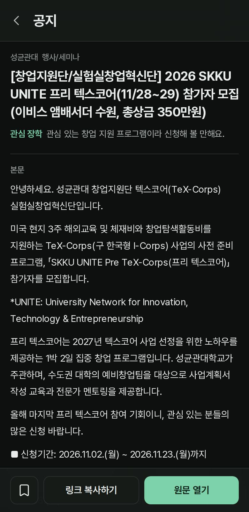 |

### 알림 설정

설정의 알림에서는 이 기기의 알림을 켜고 끄며, 등록된 기기 이름을 바꾸거나 다른 기기를 지우고, 받을 게시판을 고릅니다.

| 알림 설정: 라이트 | 알림 설정: 다크 |
|:---:|:---:|
| 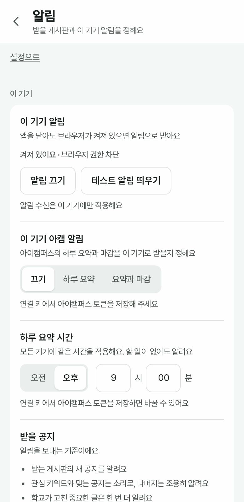 | 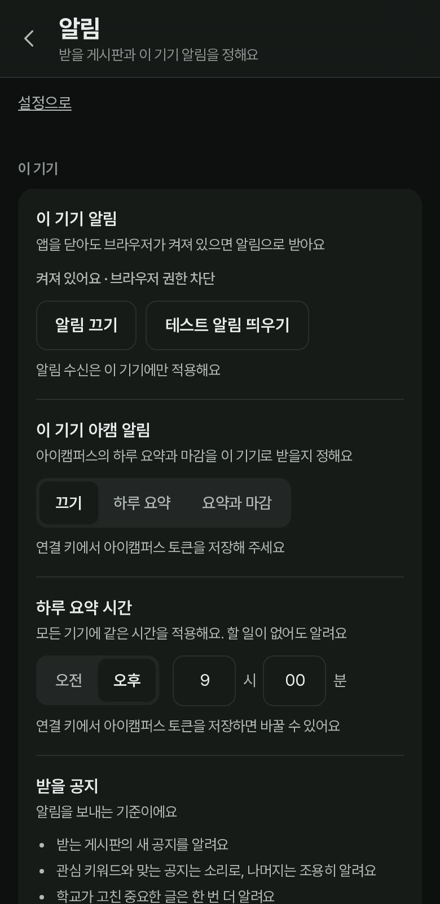 |

| 알림 기기: 라이트 | 알림 기기: 다크 |
|:---:|:---:|
| 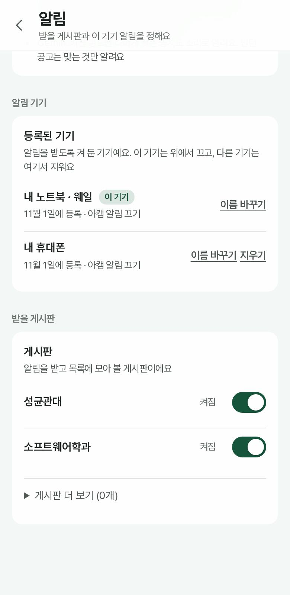 | 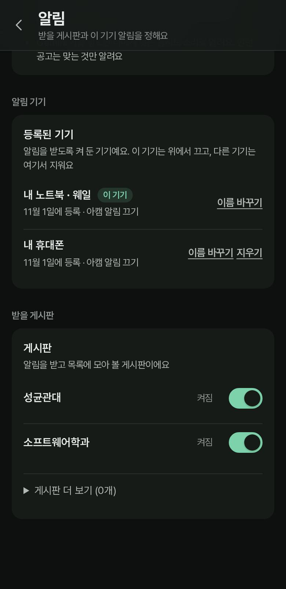 |

위 화면은 예시 계정과 예시 공지 데이터로 캡처했습니다. 키워드, 판정 이유, 마감, 기기 이름은 보여 주기 위해 넣은 값이며 실제 사용자 정보가 아닙니다. 라이트·다크·자동 모드는 설정에서 고릅니다.

## 할 수 있는 것

- **공지 보기**: 성균관대 공지, 단과대학·학과 게시판(60여 개), 부트캠프, 외부 인턴 공고(링커리어, 자소설닷컴, 학생인재개발팀)를 한곳에서 봅니다. 게시판은 로그인한 사용자가 고른 것만 수집합니다.
- **첫 로그인 설정**: 주전공과 복수전공(대학을 먼저 고른 뒤 학과), 학교 정보(학년·재학 상태·병역), 인턴십, 받을 공지(전공과 상관없는 게시판과 관심 키워드 포함), 알림, AI 키의 7단계입니다. 건너뛸 수 없고 전공과 AI 키 하나는 꼭 입력해야 끝납니다.
- **공지 읽기**: 검색, 최신순·마감순 정렬, 읽지 않은 글 보기, 선택한 공지나 현재 목록의 읽음 표시, 저장한 공지 모아 보기를 지원합니다. 관심 키워드에는 현재 보기에서 키워드에 맞는 글 수를 보여 주고, 마감이 있는 공지와 인턴 공고에는 마감을 표시합니다. 키보드로 J·K(이동), S(저장), Enter(원문), Esc(닫기)를 쓸 수 있습니다.
- **공지 상세**: 본문, 그림 속 글자(OCR로 읽은 글), 첨부 파일, 원문 열기를 한 화면에서 봅니다. 학교가 제목이나 본문을 고친 글에는 고친 날짜를 표시하고, 본문이 아직 없으면 원문으로 바로 갈 수 있게 안내합니다.
- **알림**: 웹 푸시(VAPID)로 새 공지를 보냅니다. 관심 키워드가 맞는 공지는 소리로, 나머지는 조용히 보내고 학교가 고친 중요한 글은 한 번 더 알립니다.
- **기기별 알림 관리**: 이 기기의 알림을 직접 켜고 끄며, 테스트 알림으로 도착하는 모습을 확인합니다. 등록된 기기 목록에서 기기 이름을 바꾸고 다른 기기를 지울 수 있습니다. 로그아웃하면 이 기기의 알림 등록을 해제하고 계정이 바뀌면 이전 계정의 기기 구독을 정리합니다. 키워드는 설정에서 바로 추가·삭제하고 계정에 순서대로 저장합니다.
- **화면과 설치**: 라이트·다크·자동 모드, 앱 설치(PWA), 성대 공지 탭에 "모든 게시판"이나 "받는 게시판만" 보기를 고를 수 있습니다. 서버 연결에 실패하면 마지막 공지 스냅샷을 보여 줍니다.
- **내 AI 키**: Gemini, Groq, OpenRouter 중 하나 이상을 직접 넣으면 성대 공지와 인턴 공고가 나에게 맞는지 판정해, 맞는 공지를 소리로 알립니다(무료 모델만 씁니다). 키를 여러 개 넣으면 상한 대비 덜 쓴 키부터 번갈아 쓰고, 한 곳이 막히면 다른 곳으로 넘어갑니다. 상한은 업체마다 다르게 두었고, 이미 판정한 공지는 다시 호출하지 않습니다. 키는 암호화해 서버에만 보관하며 브라우저가 읽을 수 없고, 그 사용자 본인의 공지 처리에만 쓰입니다.
- **판정 순서와 보관**: 새로 가입해 밀린 공지가 많아도 구독한 게시판의 마감이 가까운 공지부터 판정하고, 이미 마감된 공지에는 키를 쓰지 않습니다. 서버의 공지는 마감 30일 뒤(마감이 없으면 처음 본 지 90일 뒤) 지우며, 사용자가 저장한 공지는 지우지 않습니다.
- **인턴십 졸업요건 확인**: 소프트웨어학과 원전공이나 학교 3품 인턴십 요건을 채우지 않은 사용자에게, 인턴 공고에 적힌 근무 기간·시간으로 요건에 맞는지 대략 판단해 이유와 근거를 보여 줍니다. 실제 인정 여부는 학교와 학과에 확인해야 합니다.
- **아이캠퍼스 토큰(선택)**: 사용자가 직접 만든 아이캠퍼스(Canvas) 토큰으로 마감이 가까운 과제와 퀴즈를 알립니다. 설정의 "기타" 아래 "아이캠퍼스" 페이지에서 알림, 토큰, 하루 요약 순서로 정합니다. 기기마다 "끄기, 하루 요약, 요약과 마감" 중 받을 방식을 고르고, 하루 요약 시간은 직접 정합니다. 토큰은 Gemini 키와 같은 방식으로 보호합니다.
- **구글 캘린더(선택)**: 구글 로그인으로 허용하면 저장한 공지의 마감을 "성대 공지" 캘린더에 넣습니다. 한 번 연결하면 서버가 30분마다 저장한 공지를 확인해서 자동으로 맞춥니다(구글이 주는 장기 열쇠를 암호화해 보관하며, 연결을 끊거나 계정을 지우면 지워집니다). 이 앱이 만든 캘린더 안의 일정만 다루고 내 다른 캘린더는 읽지 못합니다.
- **공지 요약**: AI 키가 있으면 공지 상세에 1~3문장 요약이 자동으로 만들어지고, 실패하면 다시 시도할 수 있습니다.
- **프로필 설정**: 전공, 학년, 재학 상태, 병역과 관심 분야(주관식)를 바꿉니다. AI 판정과 인턴십 졸업요건 확인에만 쓰이며 이름, 학번, 연락처는 받지 않습니다(입학 연도만 받습니다).
- **계정 삭제와 개인정보 처리방침**: 설정 맨 아래의 "계정 삭제"로 계정과 저장한 모든 정보를 바로 지울 수 있습니다. 어떤 정보를 어디에 쓰는지는 앱 안의 [개인정보 처리방침](web/public/privacy.html)(`PRIVACY.md`와 같은 내용)에 적었습니다.
- 구독, 키워드, 저장, 읽음은 계정별로 DB에 저장하고 행 수준 보안(RLS)으로 사용자 간 접근을 막습니다. 저장·읽음의 화면 동기화는 계속 검증하고 있습니다.

## 시스템 아키텍처

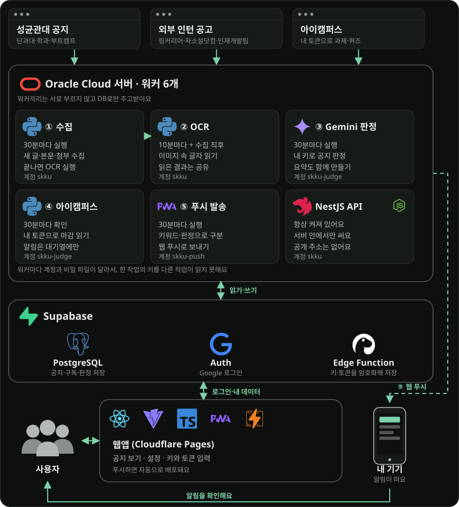

## 서버를 따로 둔 이유

웹과 키 저장은 Cloudflare Pages, Supabase Edge Function 같은 서버리스에서 돌리고, 공지를 가져오는 일은 Oracle Cloud 서버 한 대에서 타이머로 돌립니다. 포스터 이미지 한 장을 OCR로 읽는 데 100초 넘게, 메모리를 500MB쯤 써서 실행 시간과 메모리에 제한이 있는 함수에서 돌리기 어려웠습니다. 학교 게시판은 요청 사이에 간격을 두고 하나씩 읽어야 하는데, 이것도 오래 살아 있는 프로세스가 다루기 편했습니다. 또 작업마다 시스템 계정과 비밀 파일을 따로 두면 사용자 키를 푸는 작업과 푸시 비밀키를 가진 작업이 서로의 키를 읽지 못합니다. 대신 서버가 멈추면 수집도 멈추고, 재부팅 뒤 복구는 아직 확인하지 않았습니다.

## 기술 구성

[](https://www.python.org/)
[](https://www.typescriptlang.org/)
[](https://react.dev/)
[](https://vite.dev/)
[](https://nestjs.com/)
[](https://nodejs.org/)
[](https://supabase.com/)
[](https://www.postgresql.org/)
[](https://ai.google.dev/)
[](https://groq.com/)
[](https://openrouter.ai/)
[](https://pages.cloudflare.com/)
[](https://www.oracle.com/cloud/free/)
[](https://playwright.dev/)
[](https://github.com/aniseongu/skku-notice-platform/actions)

## 로컬 확인

```sh
cd web
npm ci
npm test            # 단위 테스트(Node), Supabase 정책·함수는 PGlite로 검증
npm run test:e2e    # Playwright(데스크톱·모바일)
npm run build
npm run dev -- --host 127.0.0.1
```

샘플 공지는 개발 서버 URL에 `?api=sample/api/v1`을 붙여 볼 수 있습니다. 샘플은 실제 사용자 데이터가 아닙니다. Python 테스트와 린트는 프로젝트 루트에서 실행합니다.

```sh
uv run pytest -q
uv run ruff check src tests
```

## 인증 설정

`web/.env.example`을 `web/.env.local`로 복사하고 Supabase 프로젝트 URL과 **publishable** 키를 입력합니다. 이 값은 빌드 결과에 공개되므로 secret 또는 service-role 키를 넣지 않습니다. OAuth 복귀 주소는 Supabase 허용 목록에 추가해야 합니다.

## 데이터와 마이그레이션

테이블, 함수, RLS 정책은 `supabase/migrations/`에 있습니다. 운영 DB에는 Supabase CLI로 새 파일 하나씩 적용합니다(`supabase db query --remote=<ref> -f <파일>`). 처음 파일들은 SQL Editor로 적용해서 CLI 마이그레이션 이력이 없으므로 `supabase db push`는 쓰지 않습니다. 새 환경에서는 파일 이름 순서대로 적용하세요. 키와 토큰의 암호문 열은 서비스 역할만 읽을 수 있습니다(`supabase/functions/byok/`).

수집 워커의 `SUPABASE_SECRET_KEY`, 푸시 `VAPID_PRIVATE_KEY`, 키 암호화용 `BYOK_MASTER_KEY`는 서버의 제한된 환경 파일에만 두고 프론트 환경 변수와 로그에 넣지 않습니다. 비밀과 개인 데이터는 커밋하지 않습니다.

## 수집하는 게시판 목록

수집하는 단과대학·학과 게시판은 `scripts/board_catalog.py` 한 파일에 모아 두고, 여기서 서버 설정(`config/sources.yaml`)과 웹의 게시판 목록(`web/src/skku-boards.ts`)을 함께 만듭니다. 게시판을 더하거나 고칠 때는 이 파일만 바꾼 뒤 `generate`로 다시 만들고, `verify`로 모든 게시판이 실제로 읽히는지 확인합니다. 로그인이 필요하거나 읽지 못한 게시판은 넣지 않았고, 정해 둔 주소 외의 임의 주소는 수집하지 않습니다.

## 알려진 한계

- 서버가 손으로 보낸 테스트 푸시가 기기에 도착하는 것은 웨일에서 확인했지만, 새 공지가 올라와 자동으로 보내지는 전체 경로와 아이캠퍼스 알림 도착은 계속 관찰하고 있습니다. 푸시 확인은 푸시 서비스가 있는 브라우저(Chrome, 웨일 등)에서 해야 하며, VS Code 내장 브라우저(Electron)는 웹 푸시를 지원하지 않습니다. 발송 뒤 상태를 기록하기 전에 장애가 나면 알림이 한 번 더 갈 수 있습니다.
- 무료 AI 키의 한도는 업체마다 다르고 공식 표가 자주 바뀝니다. 앱의 하루 상한은 조사한 한도보다 낮게 잡은 추정값이라, 키가 자주 막히면 조정해야 합니다.
- 외부 인턴 공고 수집은 해당 사이트의 이용약관과 robots.txt 정책을 따로 확인해야 하며, 운영자가 위험을 알고 켠 기능입니다.
- 1GB 서버에서 OCR이 긴 이미지를 처리하는 데 시간이 걸립니다. 부하가 큰 상황의 안정성은 검증하지 않았습니다.
- 사범대학, 약학대학, 의과대학 등 일부 학과 게시판은 로그인이 필요하거나 읽지 못해 목록에 없습니다.
- 개인용 서비스의 RSS 피드는 옮기지 않았습니다.
- 구글 캘린더 권한은 구글이 "민감한 권한"으로 분류해서, 앱이 구글의 검증을 받기 전에는 허용 화면에 "확인되지 않은 앱"이 나옵니다.
